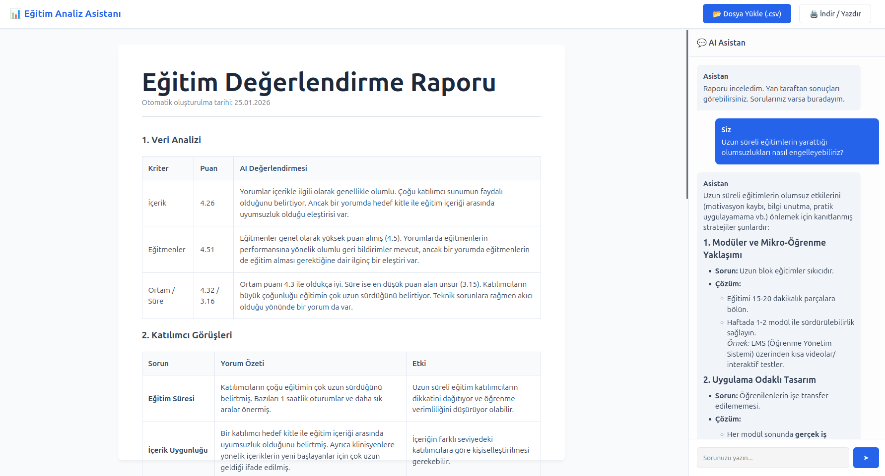
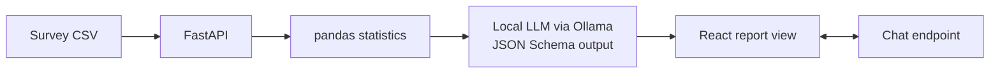

# ADA

ADA (Anket Değerlendirme Aracı) generates structured evaluation reports from training feedback surveys using a locally hosted LLM. It was developed for the Faculty of Medicine at Süleyman Demirel University, where it replaced manual report writing. All processing runs on-premise.

> This is a reduced public version. Institution-specific parts have been removed and the data in `data/` is synthetic.



## How it works

Score statistics are computed deterministically and only the interpretation is left to the model. The model never calculates figures itself, which keeps the numbers in the report correct and reduces the risk of hallucination.

1. **Statistics.** The uploaded CSV is parsed with pandas. Mean scores are computed for each criterion (content, instructors, environment, duration) and the free-text comments are collected.
2. **Report generation.** Scores and comments are sent to the LLM with a strict JSON Schema (`backend/schema.json`) as the response format. The report always contains the same sections: per-criterion analysis, participant feedback with its potential impact, SWOT analysis, action plan and executive summary.
3. **Review.** The frontend renders the report for printing or PDF export. A chat assistant, given the scores and the report as context, answers follow-up questions.



## Stack

- **Backend:** Python, FastAPI, pandas
- **LLM:** Ollama through its OpenAI-compatible API, structured output with JSON Schema
- **Frontend:** React, Vite

## Running locally

Requirements: Python 3.10+, Node.js 18+ and [Ollama](https://ollama.com) with a pulled model.

```bash
ollama pull llama3.1

cd backend
pip install -r requirements.txt
uvicorn main:app --reload
```

In a second terminal:

```bash
cd frontend
npm install
npm run dev
```

Open the URL printed by Vite and upload `data/sample_survey.csv`.

The model and endpoint are read from environment variables:

| Variable | Default |
|---|---|
| `ADA_MODEL` | `llama3.1` |
| `OLLAMA_BASE_URL` | `http://localhost:11434/v1` |

## Input format

One row per participant. Column names follow the original Turkish survey form:

| Column | Content |
|---|---|
| `Eğitimin İçeriği` | Training content, score 1–5 |
| `Eğiticilerin Yeterliliği` | Instructor competence, score 1–5 |
| `Eğitimin Süresi` | Training duration, score 1–5 |
| `Eğitim Ortamı` | Training environment, score 1–5 |
| `Öneriler` | Suggestions, free text (optional) |

Prompts and generated reports are in Turkish.
